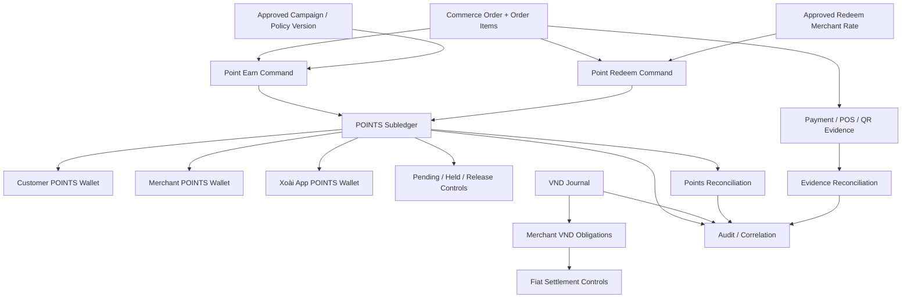

# XOÀI GO — Phase 1: Wallet Architecture Audit

**Status:** Phase 1 architecture/audit deliverable — review required  
**Date:** 2026-11-11  
**Repository:** `daoanhviet1412-ship-it/Xoaigo.vn`  
**Base branch:** `feature/xoai-core-platform`  
**Working branch:** `feature/xoai-phase1-wallet-architecture-20261111`  
**Product source of truth:** Notion — [XOÀI GO Product & Admin Control Center](https://app.notion.com/p/4113edffa9a781ddb8fbe076ccc932a8?pvs=204), especially sections 23, 24, 25 and current Blockers.

> This document is an audit and architecture proposal. It does not implement the points engine, create a migration, change Supabase, or authorize production operations.

## 1. Executive conclusion

The repository and live Supabase project contain foundations for a VND journal, member-only points accounts/entries/holds, merchant obligations, settlement records, approvals, audit events and reconciliation batches. They do **not** yet implement the three-subject POINTS ledger or operational Earn/Redeem/Release/Reconciliation commands.

The recommended architecture is to keep four distinct data concerns:

1. **Customer POINTS wallet**
2. **Merchant POINTS wallet**
3. **Xoài App POINTS wallet**
4. **VND/accounting journal**

The first three belong to a dedicated POINTS subledger. The fourth remains the existing fiat/accounting journal. Merchant obligations, approvals, reconciliation and any future guarantee/backing evidence are linked control domains, not extra wallets.

**No single balance column should be independently editable.** Wallet balances should be derived from immutable entries and bucket movements, with projections treated as rebuildable/cacheable read models.

### Phase 1 exit assessment

- Product rules: sufficient to specify the two independent Earn and Redeem allocation policies.
- Existing schema: sufficient to identify the principal gap and reuse candidates.
- New schema: design direction documented, but exact migration/table contract still requires technical review.
- Tests: acceptance matrix defined; executable engine tests cannot pass before Phase 2 exists.
- Environment: no isolated Supabase development branch; no DDL was run. Do not test schema migrations against live Supabase.

**Recommendation:** Phase 1 documentation is ready for review. Do not start Phase 2 migration implementation until the owner reviews this contract and the live-vs-repository migration discrepancy is reconciled.

## 2. Evidence and audit method

### Sources inspected

- Latest Notion Product & Admin Control Center fetched on 2026-11-11.
- Repository branch `feature/xoai-core-platform`:
  - `docs/POINTS_WALLET_LEDGER_IMPLEMENTATION_SPEC.md`
  - `docs/CORE_DATA_INTEGRATION_MAP.md` on `feature/xoai-data-integration-foundation-20261111`
  - `supabase/migrations/0018_ledger_and_reconciliation_foundation.sql`
  - `supabase/migrations/0020_points_obligations_settlement_foundation.sql`
  - `supabase/migrations/0026_audit_integrity_guards.sql`
  - `app/admin/points/page.tsx`
  - `app/admin/ledger/page.tsx`
  - `app/admin/reconciliation/page.tsx`
  - `app/admin/settlements/page.tsx`
  - `package.json`
- Read-only Supabase inspection of project `Xoaigovn` (`ozqluwawvasrsiydgeci`): migration history, public table definitions, columns, constraints and row counts from the current project inspection.

### Important scope limits

- This was a source/database metadata audit, not a browser E2E session.
- No local checkout/build/test runner was available through the connected GitHub operations.
- No SQL write, migration apply, seed, balance mutation or deployment was performed.
- Runtime RLS behavior for every role and two-user Maker-Checker behavior remain unverified.

## 3. Product rules — authoritative decisions

### 3.1 Point Earn

Source: Notion sections 23 and 24.

- Merchant funds 100% of the promotional POINTS.
- The approved store/campaign promotion rate determines the total promotional points, subject to the platform-defined limit and approved configuration.
- The total is allocated:
  - 70% to Customer Wallet;
  - 30% to Xoài App Wallet.
- The 70/30 allocation is the split between recipients; it is not the merchant's promotion rate.
- Store-specific campaign settings and policy version must be snapshotted at transaction time.
- Merchant deduction must equal Customer Pending plus App Pending.
- Earn release timing/conditions are **not** defined by the Redeem two-day rule. Keep Earn release policy OPEN until separately approved.

Illustrative allocation only: if a valid Earn command produces 100,000 POINTS, the intended allocation is 70,000 Customer and 30,000 App. This example does not settle eligible base, cap, rounding or release policy.

### 3.2 Point Redeem

Source: Notion section 25; this is separate from Earn.

- Debit Customer Wallet by the full POINTS amount used.
- Merchant Wallet receives 90% by default, or a merchant-specific rate that has been configured and approved.
- App Wallet receives the remainder (100% minus the merchant rate).
- Both recipient allocations enter Pending for at least 2 days.
- Passing 2 days does **not** automatically release Pending.
- Release requires an explicit manual approval by an authorized reviewer after risk/account review.
- Flagged transactions/accounts remain Pending/Held until handled.
- Maker cannot approve their own request.
- Snapshot the effective merchant share and policy version; later configuration changes cannot rewrite historical transactions.

Illustrative default: 100,000 POINTS redeemed at 90% merchant share -> Merchant Pending 90,000; App Pending 10,000. At an approved 85% merchant share -> 85,000 / 15,000.

### 3.3 Shared invariants

- POINTS and VND are different units and must never be merged into one balance, revenue metric or journal currency.
- Customer, Merchant and App are three distinct POINTS wallet subjects.
- Pending is a state/bucket and reporting aggregation, **not a fourth wallet**.
- Pending aggregation must not create additional ledger entries or double-count balances.
- No silent correction. Mismatches create exceptions for investigation.
- Posted history is immutable; corrections use linked reversal/adjustment transactions.
- Idempotency and stable transaction/correlation identifiers are required.
- Do not infer a point-to-VND conversion from a redemption percentage.

## 4. Current verified architecture

### 4.1 Database migration history

Live Supabase migration history currently returns 24 migrations and ends at `0024_restrict_client_table_mutations`.

The repository branch contains source for `0026_audit_integrity_guards.sql`, and Notion/history mentions migration 0026 in branch context. The live migration history does not list 0026. Therefore:

**Migration 0026 is NOT confirmed applied to live Supabase.** Do not replay, skip, mark applied or use it as a live schema fact until the exact branch source, migration ledger and resulting database objects are reconciled.

No migration was applied during this Phase 1 work.

### 4.2 Existing tables and reuse assessment

| Existing table/domain | Current shape observed | Reuse decision |
|---|---|---|
| `profiles`, `member_profiles` | Auth/profile and member identity | Reuse as identity anchors; do not duplicate customer identity |
| `merchants` | Merchant master | Reuse as Merchant Wallet owner reference |
| `marketing_campaigns`, `policy_sets`, `policy_versions` | Campaign and versioned policy foundation | Reuse; persist immutable policy/campaign snapshot on each Earn/Redeem transaction |
| `commerce_orders`, `commerce_order_items` | VND order header/lines with merchant and member references | Reuse as commerce source; order completion alone is not proof of payment |
| `points_accounts` | Account keyed to `member_user_id` + `program_code` | Member-only; cannot represent Merchant and App wallets. Must be migrated/extended carefully without two Customer balance sources |
| `points_entries` | Per-member signed delta with source and optional reversal link | Append-only foundation, but not cross-wallet double-entry transaction model |
| `points_holds` | Hold amount tied to member points account | Reassess/reuse only if generalized subject/account and bucket semantics can be preserved; do not silently overload |
| `ledger_accounts`, `journal_transactions`, `journal_lines` | VND/fiat journal; `currency` is CHAR(3) with three-letter currency check | Reuse for approved fiat/accounting only. Do not insert POINTS or use as points ledger |
| `idempotency_records` | Actor/scope/command/key/request hash/response | Reuse only after verifying retention and command uniqueness semantics fit points commands |
| `merchant_obligations` | Merchant receivable/payable with numeric amount and CHAR(3) currency | Reuse for VND obligations only; not merchant POINTS wallet |
| `settlement_batches`, `settlement_lines` | Currency-based settlement foundation | Reuse for approved fiat settlement workflow only; no payout is implemented |
| `reconciliation_batches`, `reconciliation_items` | Batch + expected/observed amount, currency and generic references | Reuse for existing fiat/general reconciliation only if typed source and unit semantics are explicit; points reconciliation needs a POINTS-safe model or a carefully generalized unit model |
| `approval_requests`, `approval_actions` | Generic request payload, maker/reviewer and action history | Reuse as approval framework only after confirming command-level atomicity, reviewer authorization and immutable evidence requirements |
| `audit_events` | Actor, action, resource, request/idempotency references, outcome, metadata | Reuse as cross-domain audit index; retain immutable domain ledger history as the authoritative transaction evidence |

### 4.3 Admin UI reality

Inspected routes:
- `/admin/points`: authenticated read-only listing of `points_accounts`; no Earn/Redeem posting or wallet balance projection.
- `/admin/ledger`: read-only VND journal accounts/transactions; no posting command.
- `/admin/reconciliation`: read-only reconciliation batches; no matching/resolve engine.
- `/admin/settlements`: read-only merchant obligations and settlement batches; no automatic debt calculation, payment confirmation, release or payout.

The UI checks the current profile and derives visible permissions from role grants/role-permission rows, but this source inspection is not proof that every underlying query is protected correctly at runtime. Database RLS and server command authorization must remain the security boundary.

### 4.4 Live data snapshot

The previous read-only project inspection recorded:
- Identity/access seed: 1 profile, 10 roles, 28 permissions, 84 role-permission mappings, 1 user-role grant.
- Merchant/member seed: 2 merchants, 1 member profile.
- Audit: 3 audit events.
- No operational rows in policies/approvals, catalog/campaigns, orders, VND journal, idempotency, reconciliation, points, merchant obligations or settlement tables.

Treat these as a dated inspection snapshot, not a promise that counts cannot change. No business transactions were created in this task.

## 5. Target architecture

### 5.1 Logical separation

The diagram describes logical ownership and links, not deployed runtime behavior.

### 5.2 POINTS subledger conceptual entities

Names below are design candidates, not approved physical table names.

| Concept | Purpose | Required attributes / constraints |
|---|---|---|
| Wallet subject/account | Represents Customer, Merchant or App owner | Subject type + subject ID; unique wallet/program identity; active/suspended state |
| Points transaction | Immutable business transaction header | Type Earn/Redeem/Release/Hold/Reverse/Adjustment; status; order, merchant, customer, campaign/policy snapshot; idempotency key; correlation ID; actor/system; timestamps |
| Points entries | Immutable debit/credit postings between wallet accounts | Transaction ID, wallet/account ID, signed integer POINTS, entry side/type, source bucket, destination bucket where relevant; no update/delete |
| Bucket projection/movement | Tracks Available, Pending and Held | Derivable from entries/events; enforce no double counting; bucket transfer must preserve total POINTS |
| Hold record | Explains why a portion is restricted | Transaction/wallet reference, amount, reason, flag source, created/resolved actor/time; hold blocks ordinary release |
| Release request/decision | Manual Redeem release workflow | Maker, checker, requested scope, eligibility timestamp, risk review, evidence, decision, reason, immutable audit |
| Reversal/adjustment link | Corrects an original transaction | Original transaction reference, new compensating transaction, reason, actor/approver; never mutate original |
| Reconciliation fact/exception | Stores expected vs observed point allocations | Transaction/correlation ID, unit=POINTS, expected/observed/difference, status, owner, evidence, resolution trail |

**Design caution:** Avoid implementing three unrelated balance tables with separately editable totals. A single ledger-entry model with wallet ownership and bucket dimensions is easier to reconcile. Whether buckets are represented as accounts, explicit movement rows or a projection is a Phase 2 schema choice; preserve one canonical source of truth.

### 5.3 VND/accounting and obligations

- Keep existing `journal_transactions.currency CHAR(3)` for conventional currencies only.
- Keep `merchant_obligations.amount/currency` and settlement amounts as fiat obligations.
- Do not mirror POINTS as VND journal lines without a separately approved accounting policy.
- Any future guarantee/backing record must be a separate, explicitly typed evidence/control domain. It must not imply that points equal VND or that Xoài holds customer funds.
- The guarantee coverage formula, accepted backing sources, custodian and legal/accounting treatment remain OPEN. No guarantee ledger design should be treated as adopted yet.

## 6. Canonical identifiers and module links

| Identifier | Must connect |
|---|---|
| `merchant_id` | Merchant master, locations, catalog, campaigns, orders, Merchant Wallet, VND obligations, settlements, audit |
| `customer_user_id` / member user ID | Auth profile, member profile, order, Customer Wallet, risk/activity history, audit |
| `order_id` | Order, order items, Earn/Redeem transaction, evidence and reconciliation |
| `campaign_id` + `policy_version_id` | Approved Earn campaign and immutable transaction snapshot |
| Redeem policy snapshot/version | Merchant share rate and approval state effective for one Redeem transaction |
| `points_transaction_id` | All point entries, bucket movements, holds, release approvals, reversal and reconciliation |
| `correlation_id` | Cross-domain command trace, idempotency and audit |
| `approval_request_id` | Maker request, checker decision, evidence and resulting release command |
| `journal_transaction_id` | VND journal only; never substitute for POINTS transaction ID |
| `obligation_id` / `settlement_batch_id` | Fiat merchant obligation and settlement trace |

Never join operational records by display name, phone, mutable description or approximate timestamp.

## 7. Authoritative flow contracts

### 7.1 Point Earn

1. Validate member, merchant, order state and approved campaign eligibility.
2. Resolve the approved campaign/policy version and snapshot it.
3. Determine eligible base and total promotional points only under an approved formula; these calculation inputs remain partly OPEN.
4. Debit merchant POINTS funding by the total points to be allocated.
5. Allocate 70% Customer Pending and 30% App Pending.
6. Commit all entries atomically with one transaction/correlation ID.
7. Reconcile merchant debit against the two Pending credits.
8. Do not release Earn Pending until a separate Earn release policy is approved.

Invariant:

`Earn merchant debit = Customer Pending credit + App Pending credit`

Expected difference = 0 after an approved rounding/remainder rule. Posting must remain disabled until that rule is approved.

### 7.2 Point Redeem

1. Validate customer available POINTS, merchant status/scope, order and redeem eligibility.
2. Resolve approved merchant share (90% default or approved store-specific setting) and snapshot it.
3. Debit Customer Wallet by the full redeemed POINTS.
4. Credit Merchant Pending by the approved merchant share.
5. Credit App Pending by the remainder.
6. Commit atomically and write audit/correlation/idempotency records.
7. Both allocations remain Pending for at least 2 days.
8. After minimum age, a qualified checker may manually approve release after risk/account review.
9. A flagged/held transaction remains blocked until a separately audited resolution.
10. No scheduler, timer or webhook may release automatically.

Invariant:

`Redeem customer debit = Merchant Pending credit + App Pending credit`

### 7.3 Release and holds

- A two-day age check applies to Redeem only, based on committed transaction timestamp.
- Age eligibility is necessary but not sufficient for release.
- Release is an explicit command with server/database authorization.
- Requester and approver must be different identities.
- Held allocation cannot pass normal release until the hold is resolved.
- Whether release can be partial/per-recipient is OPEN; do not implement partial release until approved.
- Every decision stores actor, time, scope, risk review, evidence/reference, reason and outcome.

### 7.4 Reconciliation

Earn:

`Variance = Merchant POINTS debit − (Customer Pending + App Pending)`

Redeem:

`Variance = Customer POINTS debit − (Merchant Pending + App Pending)`

Wallet projection:

`Closing POINTS = Opening POINTS + Credits − Debits`

- Expected variance is zero subject to approved rounding.
- Non-zero variance creates an exception and alert; no auto-adjustment.
- Pending overview is a read-only aggregation of underlying pending entries; it must not create another posting.
- POINTS reconciliation and VND reconciliation remain separate, with explicit units and source types.

## 8. Proposed migration roadmap (not executed)

| Step | Proposed scope | Review gate |
|---|---|---|
| M0 | Reconcile migration source/history, especially 0026; inventory constraints, triggers, RLS, grants and foreign keys | No DDL until source/live discrepancy is explained |
| M1 | Add generalized wallet subject/account identity for Customer, Merchant and App without duplicating customer balances | Confirm compatibility and transition from member-only `points_accounts` |
| M2 | Add immutable POINTS transaction header and cross-wallet entries | Prove balanced debit/credit invariants and reversal links |
| M3 | Add Available/Pending/Held bucket semantics and projection strategy | Prove bucket conservation and no Pending double count |
| M4 | Add idempotency, policy snapshot and correlation links | Same key/same payload replay; same key/different payload reject |
| M5 | Add Redeem release requests/decisions, Maker-Checker and risk/hold checks | Two independent users; no self-approval; no automatic release |
| M6 | Add points reconciliation facts/exception workflow and audit links | Injected mismatch surfaces; no auto-correction |
| M7 | Add Earn/Redeem command functions only after all required product decisions are approved | Atomicity, concurrency, security and formula tests |

This roadmap is forward-only in principle. Exact table names, migration sequence and backfill strategy require schema review. Do not drop or repurpose `points_accounts`, `points_entries` or `points_holds` before assessing references and any future live data.

## 9. Test and acceptance matrix

| ID | Test | Expected outcome | Can run now? |
|---|---|---|---|
| T01 | Earn split with a divisible total | Customer 70%, App 30%; merchant debit equals allocations | No engine yet |
| T02 | Redeem default share | Customer debit full amount; Merchant 90%, App 10% Pending | No engine yet |
| T03 | Redeem approved merchant-specific share | Merchant configured share; App remainder | No engine yet |
| T04 | Redeem below minimum age | Release rejected | No release command |
| T05 | Redeem age >= 2 days without manual approval | Still Pending; no automatic release | No release command |
| T06 | Manual release by authorized checker | Eligible allocation moves Pending -> Available; audit recorded | No release command / no second checker account |
| T07 | Maker attempts own approval | Rejected by server/database | No command / no second checker account |
| T08 | Held/flagged transaction normal release | Blocked until hold resolution | No hold/release engine |
| T09 | Same idempotency key + same payload | Original result returned; no duplicate entries | No command |
| T10 | Same key + different payload | Rejected; no new entries | No command |
| T11 | Concurrent Redeem against same Customer Wallet | No overspend/double spend; atomic result | No command / isolated DB required |
| T12 | Reversal | New linked reversal; original entries unchanged | No reversal command |
| T13 | Pending aggregate | Equals source Pending entries; no extra ledger posting | No points subledger |
| T14 | Earn/Redeem variance injection | Exception raised; no auto-correction | No reconciliation engine |
| T15 | POINTS/VND separation | POINTS cannot be written into VND currency journal | Static schema confirms currency CHAR(3); negative DB test needs isolated DB |
| T16 | Rounding/remainder boundary | Exact expected allocation under approved rule | Blocked: rounding OPEN |
| T17 | Earn eligible base/cap | Expected points follow approved base/cap | Blocked: base/cap OPEN |
| T18 | Refund after customer spent points | Correct approved compensating treatment | Blocked: refund policy OPEN |
| T19 | Partial release | Follows approved per-transaction/per-recipient rule | Blocked: policy OPEN |
| T20 | Real-money evidence match | Accepted evidence matches order and merchant | Blocked: evidence policy OPEN |

No test above is reported as passed merely because its expected behavior is documented. No engine test was run in this Phase 1 documentation task.

## 10. Open product decisions — preserve as OPEN

These are not to be filled by engineering assumptions.

1. **Earn eligible base:** before/after discounts, eligible items, mixed baskets and excluded components.
2. **Earn cap / merchant maximum rate:** platform-defined maximum and campaign/store limits.
3. **Rounding and remainder:** how non-divisible integer POINTS are allocated so the total is conserved.
4. **Earn Pending release:** duration, release trigger, reviewer and risk criteria.
5. **Redeem partial release:** whether release is per whole transaction or per recipient allocation.
6. **Risk criteria:** exact flags, thresholds, evidence and mandatory hold behavior.
7. **Refund/cancel/reversal:** full and partial cancellation; especially when customer has already spent earned points or redeemed points have been released.
8. **Merchant funding/top-up:** how Merchant POINTS funding is loaded/recognized and what happens on insufficient balance.
9. **Point expiry/dormancy:** expiry period, notices, dormant accounts and legal treatment.
10. **External evidence:** accepted QR/POS/receipt/provider evidence, matching keys, trust levels and dispute process.
11. **Settlement and merchant finance:** cadence, credit limits, fees, tax/accounting treatment and COA.
12. **Backing/guarantee:** accepted backing source, custodian, coverage ratio, calculation and legal/accounting model; no POINTS-to-VND equivalence may be assumed.
13. **App Wallet use:** whether App POINTS may fund internal campaigns, expire or be used for other purposes.
14. **Order/payment state mapping:** which order and evidence states qualify for Earn/Redeem execution.
15. **Customer/member eligibility:** account status, abuse controls and any limits not yet approved.

**Already decided — do not reopen as OPEN:** Earn split 70/30; Merchant funds 100% of Earn promotional points; Redeem default Merchant share 90% or approved merchant-specific share; Redeem remainder to App; Redeem allocations Pending minimum 2 days and manual-only release after review; no maker self-approval; Pending is not a fourth wallet.

## 11. Risks and controls

| Risk | Why it matters | Required control |
|---|---|---|
| Duplicate customer balance source | Old member-only account and new wallet model may diverge | One canonical customer POINTS balance; explicit migration/compatibility plan |
| POINTS mixed with VND | Misstates revenue, cash and liabilities | Separate subledger, units, reports and permissions |
| Wrong policy snapshot | Later campaign edits could rewrite prior allocation | Immutable policy snapshot on transaction |
| Automatic release | Violates Redeem approval decision | No timer/scheduler release path; manual command only |
| Maker self-approval | Fraud/control bypass | Database/server maker-checker enforcement |
| Partial posting | One side allocated without matching debit/credit | Atomic transaction and deferred invariant checks |
| Concurrency/double spend | Customer or merchant points can be overdrawn | Deterministic wallet locks and concurrency tests |
| Silent reconciliation adjustment | Hides missing or excess points | Exception queue; no automatic compensating entry |
| Migration 0026 discrepancy | Schema state may differ from repo assumption | Reconcile migration ledger and actual objects before DDL |
| No isolated DB | Testing migrations on live risks production data | Obtain isolated environment approval before applying DDL |
| Unresolved backing/legal treatment | Points could be misrepresented as cash or custody | Keep guarantee/backing design open; legal/accounting review |

## 12. Phase 1 completion checklist

- [x] Re-read Notion sections 23–25 and current blocker decisions.
- [x] Confirm distinct Earn and Redeem rules.
- [x] Inspect current points, VND journal, obligations, reconciliation and settlement schema.
- [x] Inspect current Admin points, ledger, reconciliation and settlements pages.
- [x] Confirm live migration history ends at 0024; 0026 remains unconfirmed on live.
- [x] Document target logical architecture, IDs, flows, migration roadmap, tests and open decisions.
- [ ] Run executable unit/integration tests — not possible before engine/schema implementation.
- [ ] Validate migration on isolated database — no isolated database branch exists and no cost-bearing branch was created.
- [ ] Runtime RLS/role matrix and independent Maker-Checker test — not completed.
- [ ] Product owner review of architecture and open-decision register.

## 13. Phase 1 handoff

**Ready for review:** architecture and audit document only.

**Not delivered:** production code, SQL migration, Earn/Redeem engine, wallet balances, release workflow, reconciliation execution, deployment or runtime verification.

**Next safe action after review:** Phase 2 migration design/review on an isolated database. Before any database apply, reconcile migration 0026 and obtain explicit approval for an isolated Supabase environment if it incurs cost. No live Supabase DDL is authorized.

**No production/main changes were made.**
